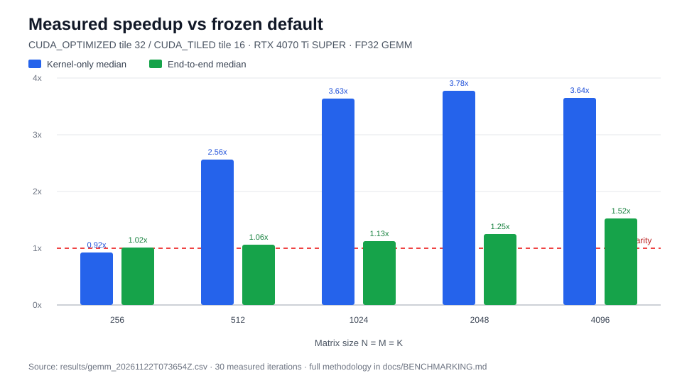

# CUDA Matrix Engine

CUDA Matrix Engine is a small, synchronous FP32 GEMM library with a CUDA-free public C++ API. It
provides a CPU reference plus three CUDA kernels (naive, tiled, and optimized), a deterministic
correctness suite, a reproducible benchmark driver, and Nsight evidence for the optimization work.
The library targets row-major matrices without transposes and keeps all CUDA-dependent code behind
`src/cuda/`, so host applications include only `cme/*.hpp`.

## Build

Requirements: Linux, CMake 3.24+, a C++17 compiler, CUDA Toolkit 12.0, and an sm_89 GPU for CUDA
execution. The default architecture is `89`; override it with `-DCME_CUDA_ARCHITECTURES=<cc>`.

```bash
cmake --preset linux-release
cmake --build --preset linux-release --parallel
```

The helper `./scripts/build.sh` runs the same configure and build steps with all library, test,
benchmark, and example targets enabled.

## Test

```bash
./scripts/test.sh
```

This script builds the debug preset, runs CTest, then runs `compute-sanitizer` memcheck and
racecheck. On hosts where the system `compute-sanitizer` is incompatible with the installed driver,
set `CME_COMPUTE_SANITIZER` to a compatible binary before running the script. GPU-dependent tests
skip cleanly with `SKIP("No CUDA device available")` on machines without a device.

## Benchmark

```bash
./scripts/benchmark.sh
```

The full run writes `results/gemm_<UTC timestamp>.csv` plus a matching `.env.txt` environment file.
Use `./scripts/benchmark.sh --quick` for a reduced 256/512 run. The methodology and CSV schema are
documented in `docs/BENCHMARKING.md`.

## API example

The following is `examples/basic_gemm.cpp` and builds as `cme_example_basic`.

```cpp
#include <iostream>

#include "cme/gemm.hpp"
#include "cme/matrix.hpp"
#include "cme/status.hpp"

int main() {
    constexpr int M = 128;
    constexpr int K = 64;
    constexpr int N = 32;

    cme::Matrix A(M, K);
    cme::Matrix B(K, N);
    cme::Matrix C(M, N);
    for (int i = 0; i < M; ++i) {
        for (int j = 0; j < K; ++j) {
            A(i, j) = 0.01f * static_cast<float>(i + 1) + 0.001f * static_cast<float>(j + 1);
        }
    }
    for (int i = 0; i < K; ++i) {
        for (int j = 0; j < N; ++j) {
            B(i, j) = 0.02f * static_cast<float>(i + 1) - 0.003f * static_cast<float>(j + 1);
        }
    }

    cme::GemmConfig config;
    const cme::Status status = cme::gemm(A.view(), B.view(), C.view(), 1.0f, 0.0f, config);
    if (!status.is_ok()) {
        std::cerr << "gemm failed: " << status.message() << '\n';
        return 1;
    }

    std::cout << "C(0,0)..C(0,3):";
    for (int c = 0; c < 4; ++c) {
        std::cout << ' ' << C(0, c);
    }
    std::cout << '\n';
    return 0;
}
```

Run it after a release build:

```bash
./build/linux-release/examples/cme_example_basic
```

Other examples are `cme_example_algorithms` and `cme_example_custom`.

## Performance case study

**Goal:** accelerate row-major FP32 GEMM while keeping the public API CUDA-free and the frozen
default unchanged.

**Bottleneck:** Nsight Compute showed the original `CUDA_OPTIMIZED` tile 32 kernel was limited by
shared-memory instruction throughput. `mio_throttle` was 13.84 cycles per issued instruction,
52.8% of total stalls, with zero shared-load/store bank conflicts and 96.70% compute and memory
throughput. Details are in `docs/PROFILING.md`.

**Change:** `src/cuda/kernels/gemm_optimized.cu` now uses a 4x4 register micro-tile with an 8x8
block for TILE=32. Shared tiles stay padded, inner loops stay compile-time unrolled, and the public
configuration API is unchanged.

**Result:** at 2048x2048x2048, kernel-only median improved from 4.598656 ms
(`CUDA_TILED` tile 16, the frozen default) to 1.216512 ms (`CUDA_OPTIMIZED` tile 32), from
3735.845543 GFLOP/s to 14122.236099 GFLOP/s. End-to-end median at 4096 improved from 87.956173 ms
to 57.728051 ms. The 256 kernel-only case is 0.92x, so the faster variant is not claimed there.



The chart compares final optimized tile 32 against the frozen default tile 16 across all measured
sizes. Full tables, methodology, profile reports, and limitations are in
`docs/PERFORMANCE_REPORT.md` and `docs/PROFILING.md`.

## Environment

Verified on Pop!_OS 24.04 LTS, Intel Core i9-14900K, 32 logical CPUs, 62 GiB RAM, NVIDIA GeForce
RTX 4070 Ti SUPER (sm_89, 16376 MiB), driver 595.84, CUDA runtime 12.0, CUDA toolkit 12.0,
CMake 3.28.3, and g++ 13.3.0. Full command output is in `docs/ENVIRONMENT.md`.

## Results and profiling

The final full benchmark is `results/gemm_20261122T073654Z.csv`. The headline kernel-only result is
**14122.236099 GFLOP/s** for `CUDA_OPTIMIZED` tile 32 at 2048x2048x2048. Tables, methodology,
hardware state, limitations, and raw profile references are in `docs/PERFORMANCE_REPORT.md` and
`docs/PROFILING.md`.

## CI scope

`.github/workflows/build.yml` installs a pinned CUDA 12.0.0 toolkit, builds all targets, and runs
CPU-side tests on a GPU-less hosted runner. GPU-dependent tests skip there. CI does **not** claim
GPU correctness; GPU correctness is established by the local test and sanitizer run above.

## Known limitations

- FP32 only; no FP16, BF16, or Tensor Core path.
- Row-major matrices only; no transposes or batched GEMM.
- Synchronous public API; no stream or asynchronous interface.
- The frozen default is `CUDA_TILED` tile 16. `CUDA_OPTIMIZED` tile 32 is faster at most measured
  sizes but must be selected explicitly.
- cuBLAS was not measured (`CME_WITH_CUBLAS=OFF`).
- Windows 11 is not available in this environment and is recorded as not tested.
- Scalar CPU reference timings are included only at 256 and 512.

## License

Apache-2.0. See `LICENSE`.
